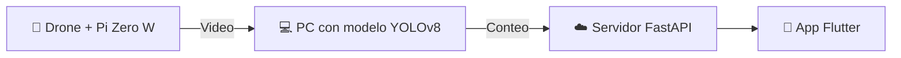

<h1 align="center"><u>🦉 NYCTUS</u></h1>

<p align="center">
  <b>Sistema Automatizado de Detección y Conteo de Fauna mediante Inteligencia Artificial</b><br>
  Prácticas Profesionalizantes 2026
</p>

<p align="center">
  
</p>

<p align="center">

<!-- Video de Presentación -->
<a href="(https://youtu.be/U8It-0T8Jfw?si=3aQN_7FjY90hRYC8)" target="_blank">
  
</a>

<!-- Gmail -->
<a href="https://mail.google.com/mail/?view=cm&to=Proyectonyctus@gmail.com" target="_blank">
  
</a>

<!-- Instagram (opcional) -->
<a href="(https://www.instagram.com/proyecto_nyctus/)" target="_blank">
  
</a>

</p>

<p align="center">
  
  
  
  
  
</p>

---

## 🎯 Descripción

**NYCTUS** es un sistema de monitoreo inteligente orientado al sector agropecuario que utiliza visión artificial e inteligencia artificial para **detectar, identificar y contabilizar animales** de manera automática.

El proyecto combina drones, procesamiento de imágenes y una estación autónoma de monitoreo para generar información útil que facilite la toma de decisiones en establecimientos ganaderos.

---

## 🚩 Objetivos

- 🐄 Automatizar el conteo de ganado.
- 🚶 Reducir la necesidad de inspecciones manuales.
- 📍 Detectar animales aislados o fuera de su zona habitual.
- 📝 Registrar información de actividad del ganado.
- 🤖 Implementar tecnologías de Inteligencia Artificial aplicadas al agro.

---

## 👥 Público objetivo

- 🌾 Productores ganaderos y establecimientos agropecuarios.
- 🏫 Instituciones educativas y técnicas interesadas en IA aplicada al agro.
- 🧑‍🔬 Investigadores y empresas de tecnología agropecuaria.

---

## 🛠️ Tecnologías

- **Hardware**: Drone con cámara, Raspberry Pi Zero W, paneles solares, comunicación inalámbrica
- **IA / Visión por computadora**: YOLOv8 (Ultralytics), seguimiento de objetos (BoT-SORT), Google Colab, Roboflow
- **Backend**: API en FastAPI desplegada en Render
- **Frontend**: App móvil desarrollada en Flutter (Dart)
- **Desarrollo**: Python, Visual Studio Code

---

## ⚙️ Funcionamiento del sistema



### 1️⃣ Captura de imágenes
Un dron con cámara realiza recorridos sobre el área de monitoreo y captura imágenes o video en tiempo real.

### 2️⃣ Procesamiento mediante IA
Las imágenes son analizadas por un modelo de visión artificial capaz de:

- Detectar animales.
- Clasificarlos.
- Dibujar cuadros de detección.
- Realizar conteo automático.
- Evitar conteos duplicados mediante seguimiento de objetos.

### 3️⃣ Estación inteligente
La estación fija permitirá:

- 🔋 Recargar el dron.
- ☀️ Alimentar el sistema mediante energía solar.
- 📡 Actuar como centro de comunicaciones.
- 💾 Almacenar información recolectada.

---

## 🧠 Modelo de IA

| Característica | Detalle |
|----------------|---------|
| **Arquitectura** | YOLOv8 (Ultralytics) |
| **Clase detectada** | `cow` (ganado bovino) |
| **Dataset** | ~21.800 imágenes (80% train / 10% val / 10% test) |
| **Entrenamiento** | Google Colab (GPU T4) |
| **Etiquetado** | Roboflow |
| **Rendimiento actual** | mAP50 ≈ 0.77 |
| **Seguimiento** | BoT-SORT personalizado |

---

## 📊 Salida del sistema

| Característica | Descripción |
|----------------|-------------|
| 🔢 **Conteo automático** | Cantidad de animales detectados |
| 🗂️ **Registros históricos** | Historial de monitoreo |
| 🚨 **Alertas** | Avisos por comportamientos anómalos |
| 📍 **Ubicación GPS** | Posición de los animales detectados |
| 📄 **Reportes** | Informes de monitoreo |

---

## 📂 Estructura del repositorio

```
NYCTUS/
├── ia/                # Entrenamiento, dataset y modelo YOLOv8
├── app/               # Aplicación móvil (Flutter)
├── server/            # API FastAPI
├── hardware/          # Drone, Raspberry Pi y estación
├── docs/              # Documentación del proyecto
```

---

## 🧑‍💻 Equipo

<p align="center">
  
</p>

| Integrante | Contacto |
|------------|----------|
| **Joaquin Ignacio Cizmadija Lepore** | [LinkedIn](TU_LINK) |
| **Juan Cruz Valiente** | [LinkedIn](TU_LINK) |
| **Facundo Bruno Videla** | [LinkedIn](TU_LINK) |
| **Lander Alvarez Andino** | [LinkedIn](TU_LINK) |
| **Galo Barrios Córdoba** | [LinkedIn](TU_LINK) |

---

## 🏫 Institución

**Escuela de Educación Secundaria Técnica N°7**
"Taller Regional Quilmes" (IMPA)

Curso: 7°1° — Comisión C

---

## 📬 Contacto

¿Querés más información, hacer consultas o proponer colaboraciones?

<a href="https://mail.google.com/mail/?view=cm&to=Proyectonyctus@gmail.com" target="_blank">
  
</a>

---

<p align="center">
  <b>Hecho con ❤️ para modernizar el agro</b><br>
  Proyecto desarrollado con fines educativos para las Prácticas Profesionalizantes 2026.
</p>
📧 **Email:** Proyectonyctus@gmail.com

---

Proyecto desarrollado con fines educativos para las Prácticas Profesionalizantes 2026.
